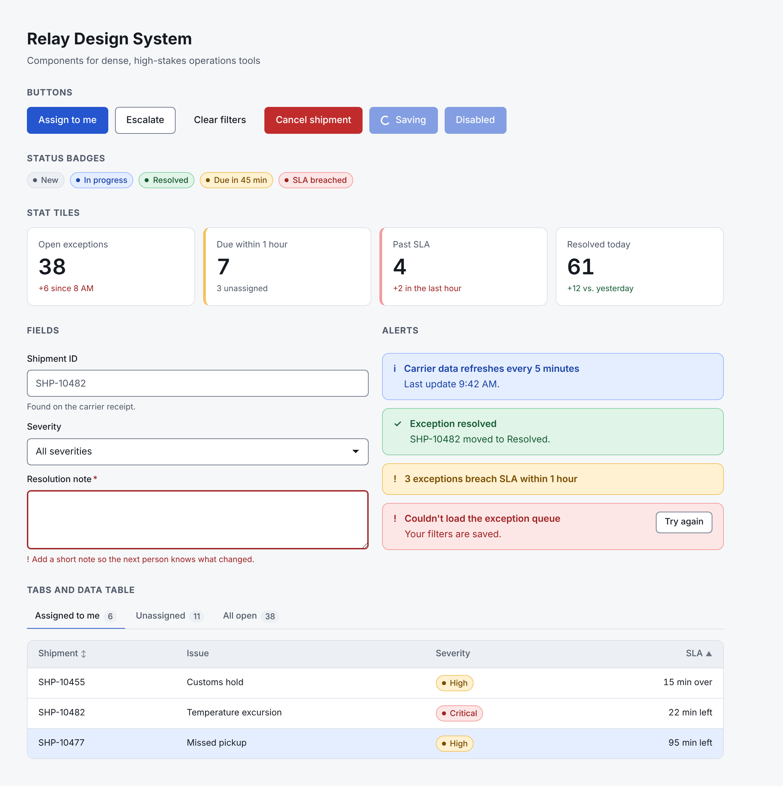
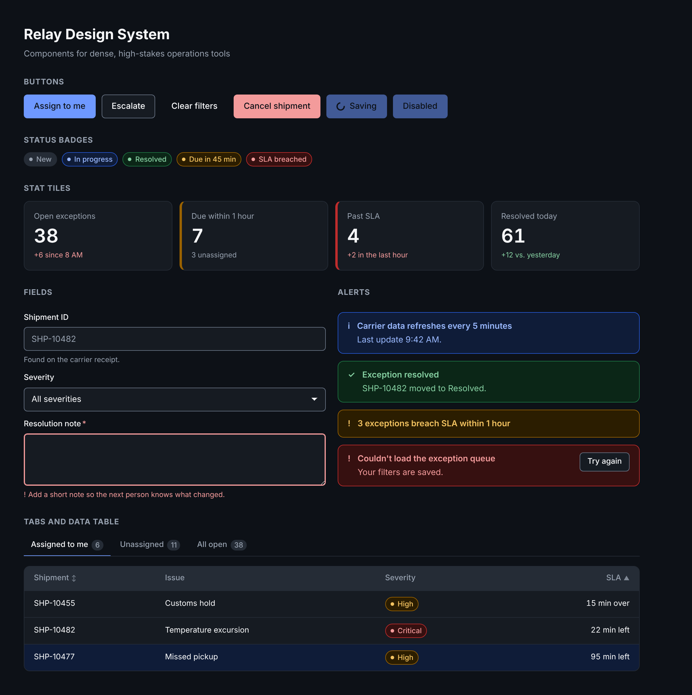

# Relay Design System

A small React + TypeScript design system for dense, high-stakes operations tools: queues, dashboards and review flows where people are busy and mistakes are costly.

**[View the live Storybook](https://holliej0.github.io/relay-design-system/)** · Used by the [Relay Ops prototype](https://github.com/holliej0/ops-console-prototype)



## Why I built it

Most of my work has been on complex enterprise and healthcare products, where a design system is what keeps 200 screens consistent and lets a team ship faster. I wanted a small, public example that shows how I think about systems: tokens with clear names, components that handle their own edge cases, and accessibility that is checked, not assumed.

## What's in it

| Part | What it shows |
|---|---|
| **Two-layer tokens** (`tokens/tokens.json`) | Primitive values (`blue-600`, `space-4`) and semantic names (`accent`, `text-secondary`, `danger-bg`). Light and dark modes only remap the semantic layer. |
| **Token build** (`scripts/build-tokens.mjs`) | Generates CSS custom properties and typed TypeScript values from one JSON source. |
| **Contrast check** (`scripts/check-contrast.mjs`) | Tests every text and UI pairing the components use against WCAG 2.2 AA, in both modes. Runs before every Storybook build, so a failing color blocks the release. |
| **8 components** | Button, Badge, TextField / TextArea / Select, Alert, StatTile, DataTable, Tabs, SidePanel. Each has stories for its states. |
| **Storybook** | Docs, a light/dark toolbar toggle, and the accessibility addon on every story. |

## Design decisions

- **Status never relies on color alone.** Badges, alerts and stat tiles always pair color with words. "SLA breached" reads the same in grayscale or for someone with a color vision difference.
- **"Up" isn't always good.** `StatTile` takes a `trend` of `good` or `bad` instead of `up` or `down`, because for queues and errors, a rising number is bad news. The meaning is also spelled out for screen readers.
- **States are part of the component.** `DataTable` owns its loading skeleton and empty state, so every screen handles "no results" the same way and the empty state can say what to do next.
- **Native where it counts.** `Select` is a styled native `<select>`, so keyboard, screen reader and mobile behavior come for free. I'd only build a custom combobox when search or multi-select is needed.
- **Keyboard first.** Sortable headers are real buttons with `aria-sort`. Table rows open with Enter or Space. Tabs use arrow keys and Home/End. The side panel moves focus in, keeps it there, closes on Escape and returns focus to where you were.
- **Errors are written as next steps.** "Add a short note so the next person knows what changed" instead of "Field required."
- **Loading buttons stay focusable.** A loading button uses `aria-busy` and blocks repeat clicks instead of becoming `disabled`, so keyboard users don't lose their place.



## Run it

```bash
npm install
npm run storybook        # opens http://localhost:6006
npm run contrast         # WCAG contrast report for light and dark
npm run tokens           # regenerate CSS and TS after editing tokens/tokens.json
```

Node 20 or newer.

## How it was built

Built with an AI coding agent (Claude) working from my brief: the domain, the stack, the scope and the accessibility bar. What the agent produced, what got corrected in review, and how the result was checked are written up in [ai-design-experiments](https://github.com/holliej0/ai-design-experiments).

## Limitations

- It's a starter system, not a full library: no date picker, combobox, toast manager or form layout primitives yet.
- Automated checks (contrast script and Storybook's axe addon) catch a lot, but not everything. I haven't tested it with real assistive technology users.
- Tokens are hand-written JSON. A larger team would likely sync them from Figma variables with a tool like Style Dictionary.

## Project structure

```
tokens/tokens.json        source of truth for all design tokens
scripts/                  token build and contrast check
src/styles/               generated tokens.css and base styles
src/components/           components, one folder each, with stories
src/foundations/          Storybook intro and token docs
.github/workflows/        builds Storybook and publishes it to GitHub Pages
```

Made by [Hollie Richmond](https://hollierichmond.com). MIT license.
